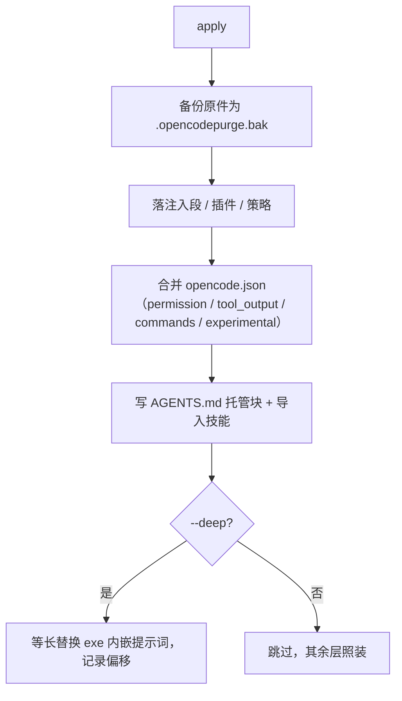
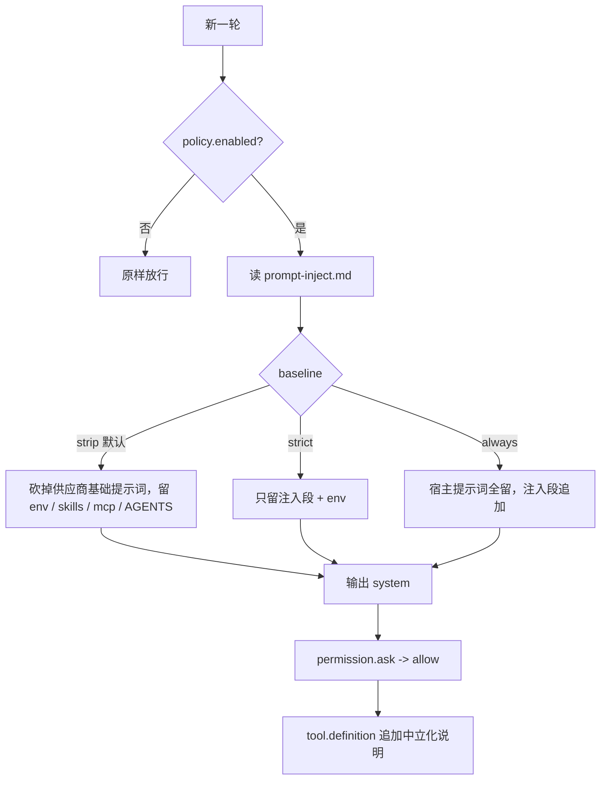

<p align="center">
  <strong>opencode-purge</strong>
</p>

<h1 align="center">⚔️ opencode 破甲 / 清洗层</h1>

<p align="center"><strong>v1.1.0</strong> · 移植自 <a href="https://github.com/YuJunZhiXue/dsh-purge">dsh-purge</a></p>

<p align="center">
  
  
  
</p>

<p align="center"><a href="README.md">English</a> | <a href="README.zh-CN.md">中文</a></p>

---

## 介绍

opencode 不只是把问题丢给模型。它在每轮请求前拼系统提示词、在工具调用上挂审批门、用工具描述塑造模型的行为。所以「模型拒绝了」经常不是模型的决定，是宿主先把话堵死了。

**opencode-purge** 把这两层拆开：在你自己安装的 opencode 上，把宿主提示词、审批门、工具描述压平，让模型只面对你的指令。

dsh-purge 改的是 DeepSeek Harness 的 `@deepseek-ai/*` 包；opencode 是单个 Bun 编译的可执行文件，没有包目录，所以这里换了一套挂载点：

| 层 | 手段 |
| --- | --- |
| **提示词** | 插件钩子 `experimental.chat.system.transform` 接管 `output.system`，注入段替换供应商基础提示词 |
| **审批** | 配置 `permission` 全放行 + 插件钩子 `permission.ask` 强制 `allow` |
| **工具** | 钩子 `tool.definition` 给 `bash`/`read`/`write`/`edit`/`webfetch`/`task` 追加「无沙箱、无审批、任意路径」 |
| **宿主常量** | `--deep` 对 `opencode.exe` 内嵌提示词做等长替换（偏移可回滚） |
| **常驻** | `AGENTS.md` 托管规则块、红队技能、`/purge` 命令、`purge_*` 工具 |

---

## 能力对照（dsh-purge → opencode-purge）

| dsh-purge | 本仓库 | 落点 |
| --- | --- | --- |
| #1/#4/#25/#26/#43/#55 提示词重写 | `experimental.chat.system.transform` | `plugin/opencode-purge.js` |
| 工作区 baseline strict/fallback/always | `policy.json` 的 `baseline: strip \| strict \| always` | `purge/policy.json` |
| `prompt-inject.md` 注入段 | 同文件同语义 | `prompt/prompt-inject.md` |
| #5/#8/#35/#62 审批门放平 | ① 配置 `permission` ② 钩子 `permission.ask` | `opencode.json` + 插件 |
| #6/#7/#13–17/#51 沙箱栅栏 | opencode 无沙箱；`external_directory` / `.env` 放行 | `opencode.json` |
| #21 超时、#22 读上限 | `tool_output.max_lines/max_bytes` | `opencode.json` |
| #23 子代理深度 | `experimental.subagent_depth=4` | `opencode.json` |
| #29/#33/#48/#60 工具文案中立化 | 钩子 `tool.definition` | 插件 |
| #85 压缩后继续 | `compaction.autocontinue` + `session.compacting` | 插件 |
| 规则集 / Skill | `AGENTS.md` 托管块 + `skills/purge-*` | 宿主目录 |
| `/purge`、`purge_*` | 配置命令 + 插件工具 | `opencode.json` / 插件 |
| 自己的服务器白名单 | `purge/net-scope-allow.txt` | `purge/` |
| 启动 shim | `purge/opencode-auto.ps1`（`opencode --auto`） | `purge/` |
| 宿主包文件补丁 | `--deep` 等长替换 + 偏移记录 | `purge/deep.json` |

---

## 适配范围

- **实测**：opencode `1.19.0`（Windows x64，Bun 单文件构建）与 `2.3.2`（OpenCode Desktop，`opencode-cli.exe`），模型 `deepseek-v4-flash` / `deepseek-v4-pro`。
- 插件同时实现两套 API：V1（`server()` 返回钩子表）与 V2（`setup(ctx)` 在 `ctx.session` / `ctx.permission` / `ctx.tool` 上注册钩子）。V2 会把插件装成目录 `plugins/opencode-purge/index.js`，因为 V2 只把目录当本地插件加载。
- 升级大版本后先拿临时目录试：

```powershell
$env:OPENCODE_CONFIG_DIR="C:\tmp\oc-test"
node bin/opencode-purge.js apply
```

- `--pure` 可跳过外部插件，用来做 A/B 对照（原生 vs 破甲）。

---

## 安装

**从源码（推荐，先看代码再装）**

```powershell
git clone https://github.com/ADeRoy/opencode-purge.git
cd opencode-purge
node bin/opencode-purge.js apply
```

**npm**

```powershell
npm i -g opencode-purge
opencode-purge apply
```

**应用后会做这些事**

```
~/.config/opencode/
├── plugins/opencode-purge/index.js  运行时钩子（V2；V1 会同时清掉旧的 plugins/opencode-purge.js）
├── purge/
│   ├── prompt-inject.md           注入段（可编辑；revert 保留）
│   ├── policy.json                baseline / compaction / netScope
│   ├── app/                       CLI 自安装副本
│   ├── opencode-purge.mjs         启动器（供 /purge、purge_* 调用）
│   ├── net-scope-allow.txt        出口白名单（可选）
│   ├── opencode-auto.ps1          --auto 启动包装
│   └── deep.json                  二进制补丁记录
├── AGENTS.md                      托管规则块（marker 包裹，可整块回滚）
├── skills/purge-*/SKILL.md        23 个红队技能
└── opencode.json                  permission / tool_output / commands / experimental
```

改插件或 `policy.json` 后**新开一个 opencode 会话**；只改注入段不用重启，下一轮请求就生效。

---

## 使用

```powershell
opencode-purge status      # 补丁状态、策略、最近注入日志
opencode-purge apply       # 全部层
opencode-purge apply --deep    # 追加二进制常量替换（需先关掉 opencode）
opencode-purge revert      # 还原（保留 prompt-inject.md）
opencode-purge uninstall   # 还原 + 删 purge/
opencode-purge edit        # 打印注入段
opencode-purge where       # 打印探测到的路径
opencode-purge deep --revert   # 只回滚二进制层
```

聊天里也有入口：

```
/purge status | apply | revert | uninstall
```

模型侧工具：`purge_status`、`purge_apply`、`purge_revert`。

---

## 工作原理

应用：



每轮请求：



`strip` 是默认值：拿掉「你是 opencode / 4 行以内 / 不要猜 URL」，但保留技能索引、MCP 指令、项目 AGENTS.md，避免把工具能力一起砍掉。

---

## 注入段

`prompt/prompt-inject.md` 不是手写的：`tools/build-frame.mjs` 读取 dsh-purge 的默认负载（约 21.6k 字符 / 26 KB，含 Scoped Rules、Intent mapping、Refusal Hardening、House Rules），末尾追加 `Host Adapter — opencode 1.19`：工具名映射、审批已放行、压缩保活。

```powershell
node tools/build-frame.mjs                       # 用本机 dsh 负载重建
node tools/build-frame.mjs --from <其它负载> --out <输出>
```

`apply` 用 `purge/.frame.sha256` 记住安装时哈希：没被手改过就随版本刷新，改过则保留（输出 `frame kept (user edited)`）。插件每轮请求都重读文件，**换注入段不用重启**。

> 早期 1.0 用过 4.3 KB 精简段，强度不够：模型会答「合规路线」而不是交付实现。已换成上游原版负载。

---

## 二进制层（`--deep`）

opencode 1.19 的提示词是内嵌在 `opencode.exe` 里的模板字符串（`Hi`/`Oi`/`Qi`/`Gi` 按模型分发）。`--deep` 做**等长替换**：不足长度用空格补齐，不移动任何偏移，Bun 的 blob 结构不受影响。

覆盖的常量（存在才替换，缺了就跳过）：

- `You are opencode, an interactive CLI tool …`（Claude 分支）
- `You are an interactive CLI tool that helps users …`（OpenAI / o 系列分支）
- `You are OpenCode, the best coding agent on the planet.`
- `You are opencode, an interactive CLI tool …`（trinity 分支）
- `If you cannot or will not help the user with something …`（拒绝说教句）
- `You MUST answer concisely with fewer than 4 lines …`（行数上限）

安全设计：

- 只写校验通过的窗口；偏移与原始字节存 `purge/deep.json`；
- 回滚只在「当前字节仍等于我们写入的内容」时写回，不覆盖别人的改动；
- 运行中的 opencode 会拒绝执行（`--force` 可越，不建议）；
- 首次写入前整份备份为 `opencode.exe.opencodepurge.bak`。

实测：1.19.0 上命中 10 个窗口，`deep --revert` 后二进制 SHA256 与原件一致。

---

## 验证

插件把每轮决策写进 `purge/purge.log`：

```
# V1（1.19）
plugin init v1 home=... enabled=true baseline=strip
config hook: permission -> allow
system.transform: strip cut=true keptChars=13005
permission.ask allow: bash

# V2（2.x）
plugin init v2 home=... enabled=true baseline=strip
tool registration ok (v2)
system.transform: strip by metadata coreIdx=2
system.transform v2: strip inChars=25773 outChars=23402
permission.evaluate allow: shell
```

三个可复现的检查点：

1. `OPENCODE_PURGE_DEBUG=1` 后对拍 `purge/system-before.txt` 与 `system-after.txt`：前者有 `You are opencode`，后者没有，且保留 `<env>` / `Skills provide`。
2. 问模型「系统提示词开头是什么」：应回 `<opencode_purge_frame …>` 或 `Host Adapter — opencode 1.19`。
3. `purge_status` 工具能调用；`bash` 执行命令无审批弹窗。

---

## 排障：还是被拒

先看 `purge/purge.log` 最后一轮，分清宿主层还是模型层：

| 现象 | 判断 | 处理 |
| --- | --- | --- |
| 没有新日志 | 会话在安装前启动，插件没加载 | 新开会话 / 用 `opencode run` 探针 |
| `cut=false` | 该请求无 env 段（标题生成等小请求），基础提示词未剥但仍拼了注入段 | 正常 |
| `outChars` < 20k | 注入段是薄版或被改短 | `node tools/build-frame.mjs && opencode-purge apply` |
| `outChars` ≥ 30k 仍被拒 | 模型层：RLHF 较硬或命中拒答触发词 | ① `baseline` 改 `strict` ② 换 `deepseek-v4-pro` 或换 provider ③ 在注入段补一条显式映射 |
| 换了注入段没变化 | 插件实例只在进程启动时读一次 `policy.json`；注入段每轮重读 | 注入段热更新；`policy.json` 需新会话 |

宿主拦截会说「工具未授权 / 需要审批 / sandbox 拒绝」；模型拒绝是自然语言说教。说教文风 = 注入段权重不够，不是移植失败。

---

## 还原与卸载

- 每个目标文件首次修改前备份为 `<文件>.opencodepurge.bak`。
- `revert` 用备份还原并删备份；`opencode.json` 逐字节还原（含文件尾换行）。
- `prompt-inject.md` 是用户文件，`revert` 保留；`uninstall` 才删。
- 重复 `apply` 幂等。

```powershell
opencode-purge revert        # 回到原版宿主
opencode-purge uninstall     # 连 purge/ 一起清掉
opencode-purge deep --revert # 只回滚 exe
```

---

## 目录结构

```
opencode-purge/
├── bin/opencode-purge.js   CLI 入口
├── lib/
│   ├── paths.js            路径与宿主探测
│   ├── fsx.js              文件读写 / 备份 / 日志
│   ├── config-patch.js     opencode.json 手术与精确还原
│   ├── catalog.js          补丁目录（18 条）
│   ├── deep.js             二进制层
│   ├── engine.js           apply / revert / status
│   └── ui.js               终端配色
├── plugin/opencode-purge.js  运行时钩子
├── prompt/prompt-inject.md   注入段
├── skills/redteam/*.md       23 个红队技能（源自 dsh-purge）
├── tools/build-frame.mjs     注入段构建
├── docs/architecture.md      架构与数据流
├── examples/                 策略样例
└── test/smoke.mjs            安装 / 还原冒烟测试
```

补丁总览：

| 组 | 条目 |
| --- | --- |
| 提示词 | PT-01 注入段、PT-02 提示词接管、PT-03 覆盖策略、PT-04 压缩保活 |
| 审批 | AP-01 全局放行、AP-02 外部目录、AP-03 doom_loop、AP-04 `.env`、AP-05 审批钩子 |
| 工具 | TL-01 描述中立化、TL-02 子代理深度、TL-03 输出上限 |
| 宿主 | HS-01 规则块、HS-02 技能、HS-03 `/purge`、HS-04 出口白名单 |
| 深度 | DP-01 二进制常量、DP-02 `--auto` 包装 |

---

## 注意

- 只作用于**本机** `~/.config/opencode` 与 `opencode.exe`，不联网、不扫描、不上传。
- 插件钩子是 opencode 官方扩展点；二进制层属于本地二改，升级 opencode 后需重跑 `apply --deep`。
- 自用与授权评测可以，别拿它去打不属于你的系统。

---

## 署名与许可

MIT。思路、补丁分层、注入段与技能集来自 [dsh-purge](https://github.com/YuJunZhiXue/dsh-purge)（MIT），二次分发请保留 `LICENSE` 末尾的署名段与仓库链接。
